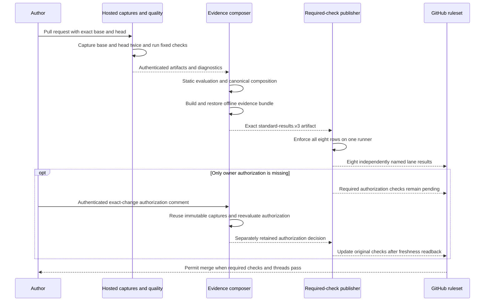

# Pull Request Lifecycle

## From change to merge

1. **Prepare the change.** Keep the base contract authoritative, refresh the review evidence, and
   preserve or explicitly migrate the applicable characterization obligations. Include meaningful
   tests for changed and high-risk responsibilities.
2. **Bind owner authorization when required.** The existing format must match the current base,
   head, changed scope, targets, and series. [Refactor Authorization](Refactor-Authorization.md)
   explains the exact trusted-owner boundary.
3. **Run the pinned workflow.** GitHub checks out immutable target commits and trusted Gate source
   separately. Fixed dependency provisioning occurs under the hosted supervisor; target execution
   occurs inside the defined isolated container boundary.
4. **Capture and authenticate evidence.** Successful scenarios run twice at each revision; a failed first execution is retained without
   repeating it. Quality execution
   retains fixed command vectors, outcomes, source and dependency receipts, and observed coverage.
   Artifact metadata and digests must match repository, commits, workflow, run, and attempt.
5. **Evaluate and compose.** Static parsing and the policy modules produce canonical evidence.
   The composer produces eight rows in `standard-results.v3` and a derived review handoff.
6. **Retain a restorable bundle.** The evidence job builds a compact qualification bundle and
   validates restoration with networking disabled before authoritative upload succeeds.
7. **Inspect each required lane.** One trusted publisher enforces every row from the authoritative
   artifact and creates the eight independently named required checks. A blocking row makes the
   publisher job fail after all eight results are posted, without allocating eight more runners.
   If the only unresolved evidence is a missing owner authorization, the affected required checks
   instead remain **Awaiting owner authorization**. The collection workflow completes; merging
   remains blocked by those pending checks. The canonical evidence still says `BLOCK`.
8. **Merge normally.** All required checks must bind to the final head and all actual inline
   conversations must satisfy GitHub's native resolution rule. Source-repository protections apply
   additionally when the change is to the Gate itself.

A verified schema-5 correction can complete evidence verification successfully while its behavior
change still awaits owner authorization. The composer validates that process outcome separately
from approval: it retains the declared behavior-change blocks until the existing owner policy
authenticates a matching grant. Verification errors or unrelated behavior failures remain failures.

## What a new push changes

A new head creates a new evidence identity. Refresh source-bound declarations and any required
owner authorization; obtain fresh captures and checks. Earlier green results, archived bundles,
or local runs cannot qualify the new head.

## Authorization continuation

Install the pinned authorization event receiver described in
[Repository Configuration](Repository-Configuration.md#authorization-event-receiver) on the
repository's default branch. Organization ruleset workflows do not receive comment events.
The receiver handles authorization comments and evidence-workflow completion, including a comment
that arrives while capture is finishing. It does not post authorization on the owner's behalf.

The shared continuation authenticates the native required-workflow identity, repository, run, attempt,
artifact digest, Gate revision, and exact current base/head. It restores and recomposes the original
evidence before asking the existing refactor policy to evaluate live GitHub comments. Consumer code
is never imported or executed. No dependency installation for the consumer, capture, or test rerun
is necessary for an authorization-only decision.

The receiver identifies GitHub-native required-workflow runs using their consumer-specific metadata,
not a source repository workflow ID or display name. It verifies the sole matching effective
organization workflow rule, source repository, path and qualified revision before accepting a run.
An ordinary consumer workflow with the same name or path cannot supply authorization evidence.

The read-only evaluator retains a new bundle with the original capture identity and a separate
`authorization-resume.v1` record identifying the continuation run and owner comment. A different job,
with no consumer checkout, updates the original GitHub Actions check runs. It reads back the current
comparison, latest capture, and authorization comments before publication. Repeated events update
the same checks; they do not create competing green results.

Before reevaluation, a job without consumer code withholds the previous authorization check.
Invalid or duplicate current-head grants, wrong owners, changed oracle bytes, stale comparisons,
missing artifacts, and actual behavioral or quality failures remain blocking. Changing or deleting
authorization triggers reevaluation. GitHub event delivery is asynchronous; after invalidation,
a receiver failure leaves authorization pending and reports a continuation error. Expired evidence
requires fresh captures. A receiver pinned to a different Gate revision rejects the evidence;
update it together with the qualified organization workflow pin.

## Preservation and correction lanes

A refactor remains the default lane: base and head behavior must be identical. A correction stays
inside the same pull request and review cycle but has two Git stages. First commit the schema-5
declaration and all expected cases, goldens, reviews and source receipts without production-code
changes. Then commit the implementation without altering those oracle bytes. After the final head
exists, the trusted owner posts one schema-5 exact-head authorization binding both commits and the
complete observed delta. The existing workflow and eight contexts enforce both lanes; no new check
or external semantic service is involved.

## Short tasks and advisory review

Only the exact narrow [short-task classifier](Boundaries-and-Limitations.md#short-task-classification)
permits irrelevant lanes to report `NOT_APPLICABLE_SHORT_TASK`. Gate 7 still runs. Ordinary
documentation edits do not automatically qualify for the exception.

Codex review is optional, owner-requested advisory input and is not a required check. Any inline
conversation it creates remains subject to native thread resolution. Semantic Review is retired.

Implementation references: [required workflow](../../.github/workflows/organization-required.yml),
[producer](../../src/supportability_gate/standard_results_producer.py), and
[enforcer](../../src/supportability_gate/standard_results_enforcer.py).

A completed GitHub check cannot be reopened by clearing its conclusion. If an owner grant is
changed or removed after success, continuation first changes the original authorization check to
**Action required**, then reevaluates live evidence. Previously completed approval-dependent checks
remain Action required while approval is missing; initially undecided checks remain pending.
Restoring a matching grant updates those same check IDs to success without recapture. The publisher
verifies the state returned by GitHub instead of assuming a successful request applied the change.
